# PAM_Teleport

A Docker lab for privileged access management in the Full Banking System project. Follow one SSH session from MFA sign-in to audit playback. Teleport records who signed in (`admin`), which resource they opened (`localhost`), and which Linux account they used (`root` inside the lab container).

## Demo Vidoe

https://github.com/user-attachments/assets/6f0733ae-c5b8-44f4-951a-562c2ddd1916


[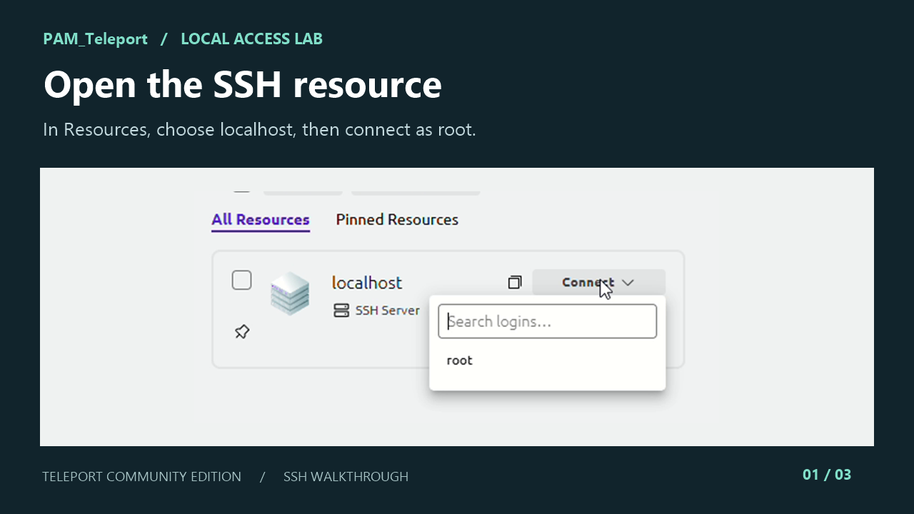](media/pam-walkthrough.mp4)

## Run the lab

You need Docker Desktop in Linux container mode, Docker Compose v2, and internet access for the initial build. Open **Windows Command Prompt** in the directory containing `compose.yaml`.

1. **Start Teleport.** The default browser port is `3080`. If another Teleport container already uses it, first run `set PAM_WEB_PORT=13080` in the same CMD window. This project uses its own named volume.

   ```cmd
   docker compose up -d --build --wait
   docker compose exec teleport tctl status
   ```

   Look for cluster `localhost` and Teleport `18.11.10`.

2. **Enroll your local administrator.** Run this once for a new cluster. Open the private invitation printed by the command, set a password, and register an authenticator. If you selected port `13080`, change the port in the invitation URL to match.

   ```cmd
   docker compose exec teleport tctl users add admin --roles=editor,access --logins=root
   ```

   An existing account can use the [reset procedure](docs/operations.md#recover-an-existing-admin-account).

3. **Open an SSH session.** Sign in at [localhost:3080](https://localhost:3080) or [localhost:13080](https://localhost:13080). The local proxy uses a self-signed certificate. Choose **Resources → localhost → Connect → root**. Run these commands in the browser terminal.

   ```sh
   /busybox/whoami
   pwd
   exit
   ```

   The first two commands should print `root` and `/root`.

4. **Find the evidence.** Open **Audit → Session Recordings**, select your completed session, and replay the terminal activity. Match the Teleport user and resource to the connection you just made. The example in the video lasted 25 seconds.

## Ten ways teams use PAM

The SSH and session-review illustrations use frames from the actual lab. The other eight are **reference scenarios** for separately enrolled services. Each image opens a short field guide with the access decision, an example verification, and the relevant Teleport documentation. The sample roles and workload names illustrate policy choices.

| | |
| --- | --- |
| [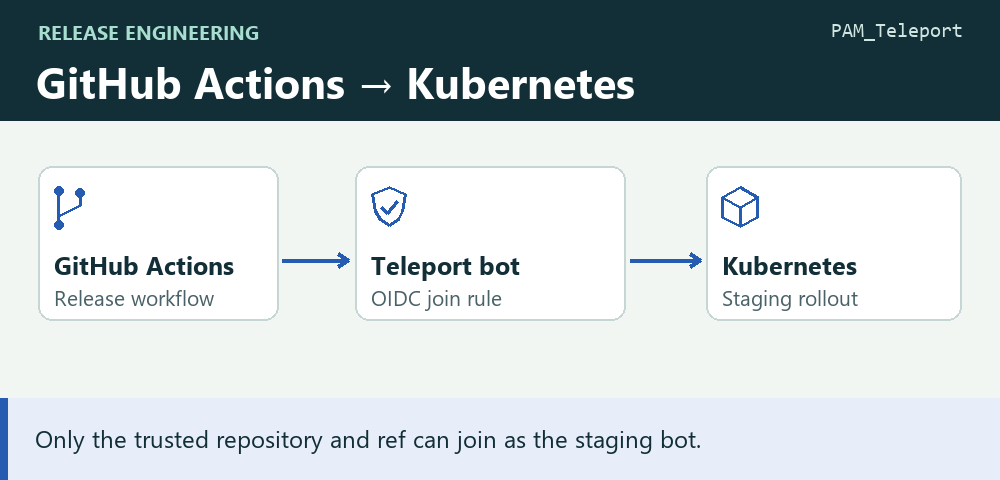](docs/use-cases.md#github-kubernetes) | [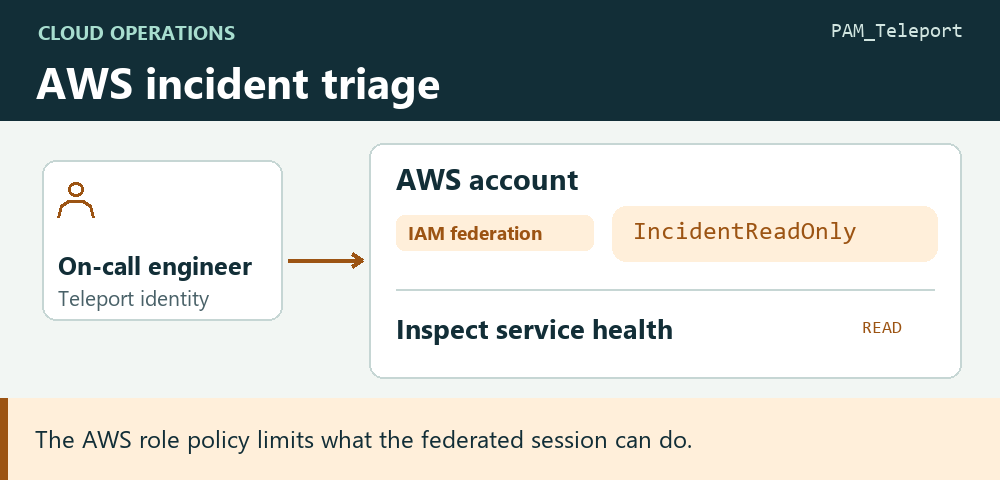](docs/use-cases.md#aws-console) |
| [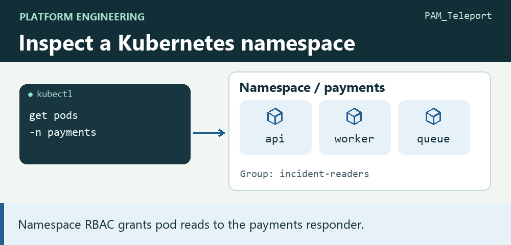](docs/use-cases.md#kubernetes-namespace) | [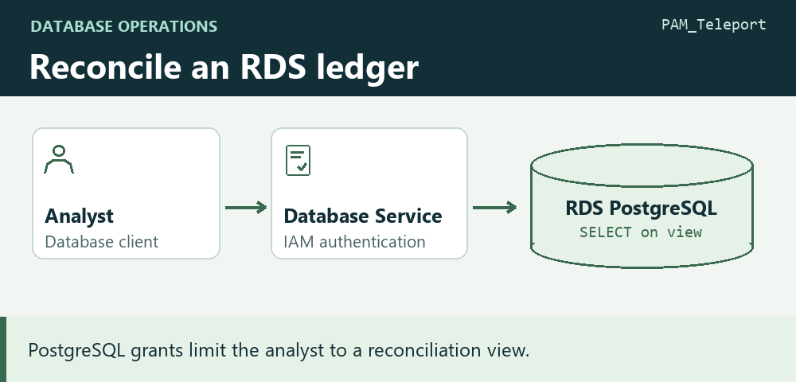](docs/use-cases.md#rds-postgresql) |
| [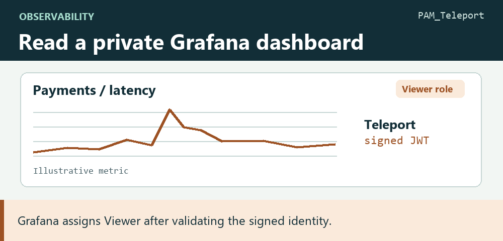](docs/use-cases.md#grafana) | [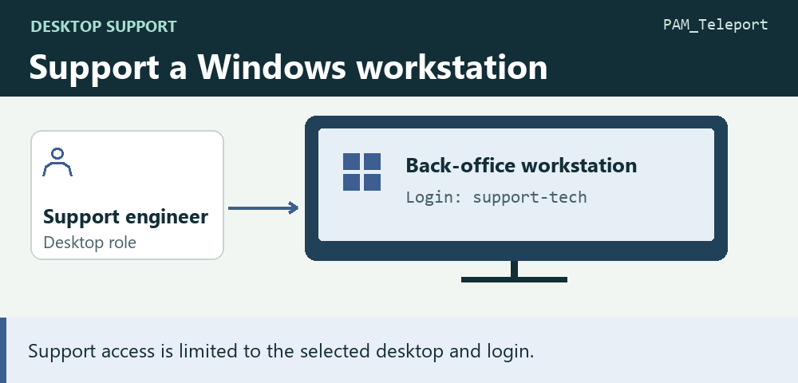](docs/use-cases.md#windows-desktop) |
| [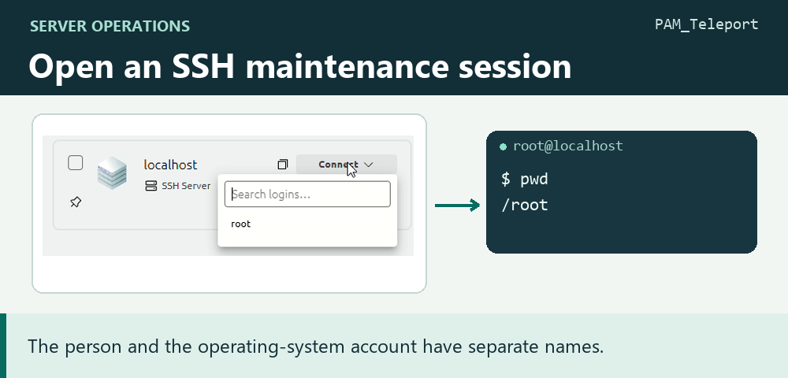](docs/use-cases.md#ssh-maintenance) | [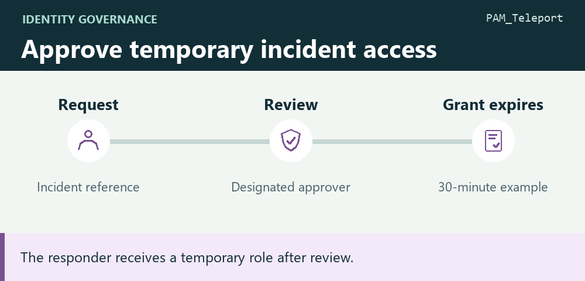](docs/use-cases.md#access-request) |
| [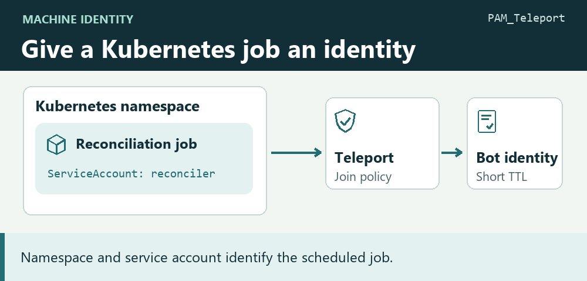](docs/use-cases.md#kubernetes-workload) | [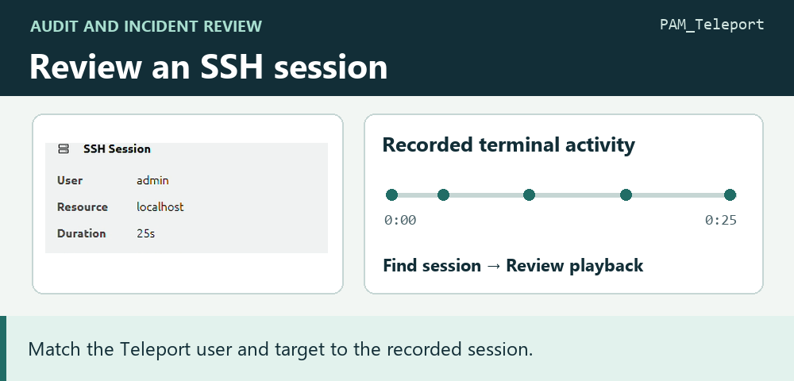](docs/use-cases.md#session-review) |

[Read all ten use cases with verification examples](docs/use-cases.md)

## What runs locally

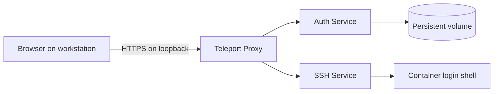

The deployment runs Teleport Community Edition with Auth, Proxy, and SSH in one container. The debug image supplies BusyBox for the interactive shell. A root session shares the container with the cluster authority, so use disposable local data. The cloud and banking workloads in the illustrations require separate infrastructure. [Security model](SECURITY.md)

| Project file | Purpose |
| --- | --- |
| [Compose deployment](compose.yaml) | Loopback port, health check, and persistent cluster state |
| [Teleport configuration](config/teleport.yaml) | Cluster name and enabled services |
| [Dockerfile](Dockerfile) | Pinned image version and root login shell |
| [Operations guide](docs/operations.md) | Restart, account recovery, and SSH troubleshooting |
| [Validation workflow](.github/workflows/validate.yml) | Builds a fresh lab and checks the web API, SSH node registration, and root shell |
