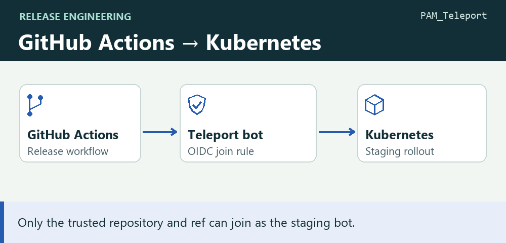
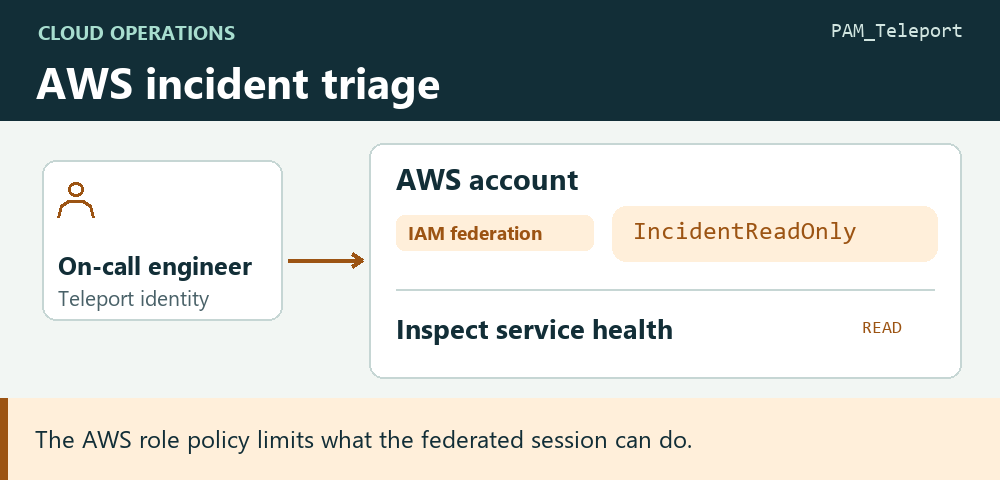
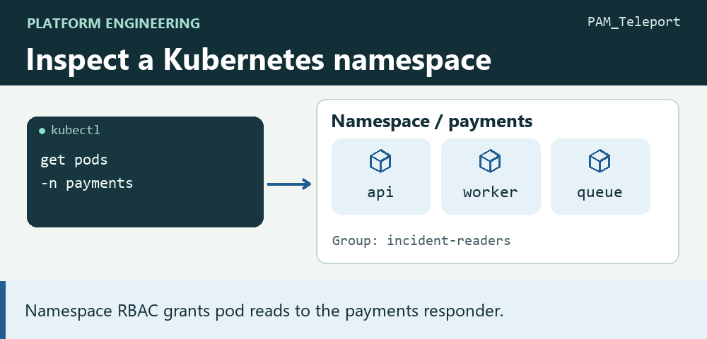
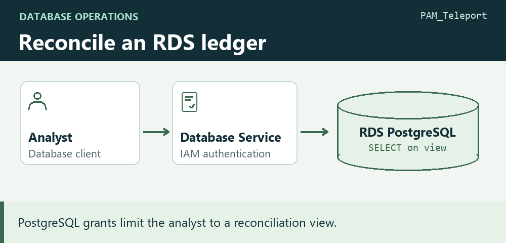
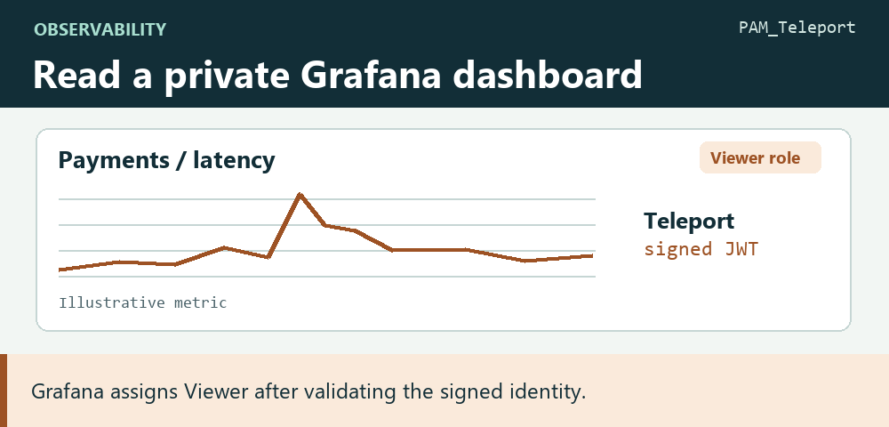
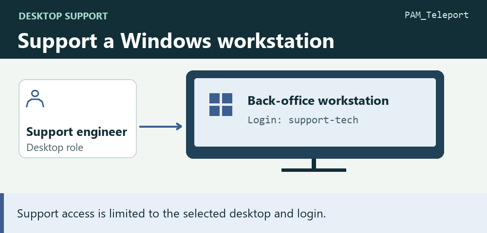
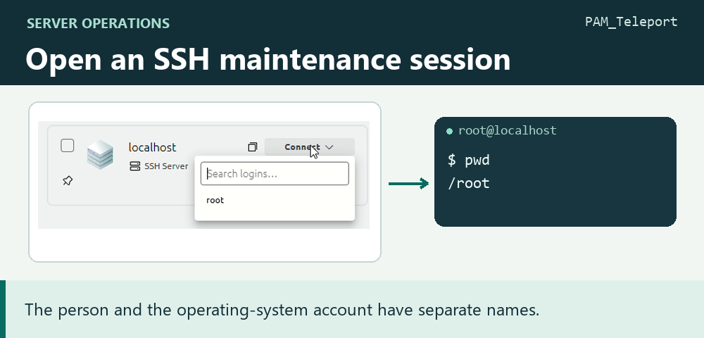
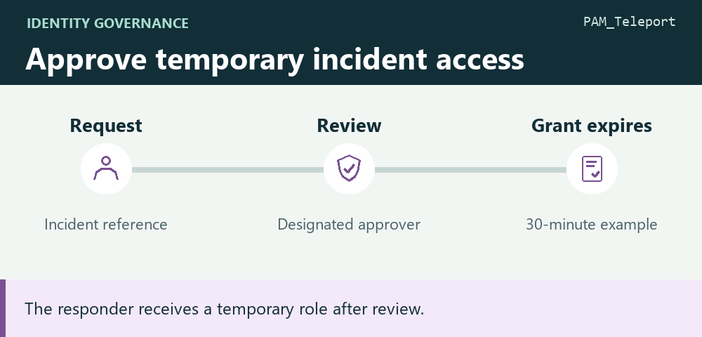
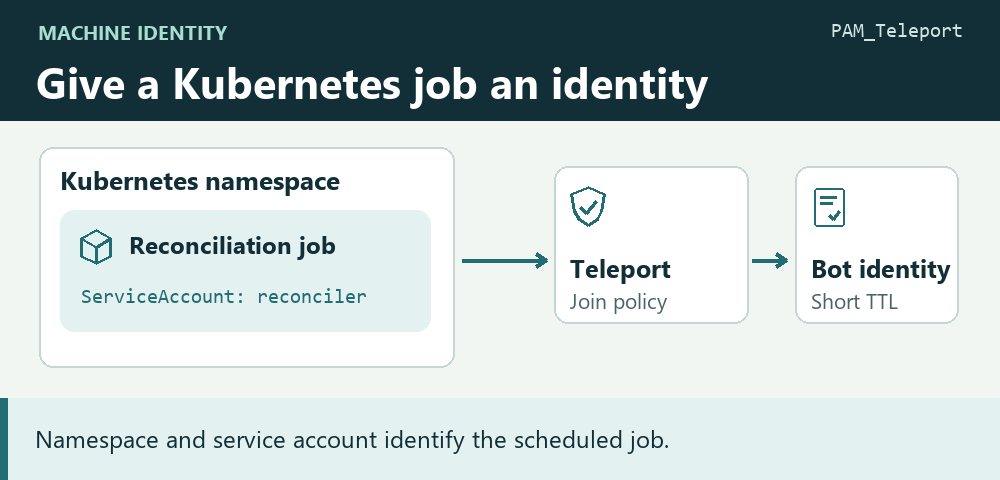
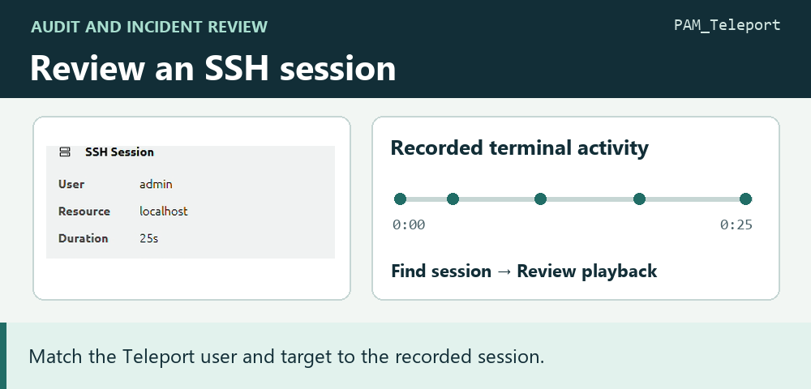

# PAM use cases in a banking environment

Use these illustrations to trace an access decision from identity to resource. **Local demonstration** identifies a scenario you can reproduce with this repository. **Reference design** identifies an example that requires additional resources, policy, and any applicable product entitlement. All names and time windows in the designs are illustrative.

[Return to the lab and demo](../README.md)

## GitHub Actions → Kubernetes

**Reference design** · Release engineering

A release workflow checks a rollout in staging. The runner presents its GitHub OIDC identity to Teleport. A matching join rule issues a short-lived bot identity that can read the deployment status.

**Access control.** Match the allowed repository and ref. Map the bot to a Kubernetes group with read access in staging.

**What to verify.** A job from the permitted ref can read the rollout. A job from a different repository cannot obtain that bot identity.

[GitHub workflow identity](https://goteleport.com/docs/machine-workload-identity/getting-started/)

## AWS incident triage

**Reference design** · Cloud operations

An on-call engineer checks the AWS console during a payment-service incident. Teleport permits a federated session for a read-only IAM role. AWS evaluates what that role can do.

**Access control.** Restrict which IAM role the engineer can assume and scope the role’s AWS permissions to the investigation.

**What to verify.** The console shows the expected assumed role. The engineer can inspect service health while changes remain outside the role’s permissions.

[AWS console access](https://goteleport.com/docs/enroll-resources/application-access/cloud-apis/aws-console-without-agent/)

## Inspect a Kubernetes namespace

**Reference design** · Platform engineering

A platform engineer investigates unhealthy payments pods. Teleport maps the engineer to a Kubernetes group. A namespace RoleBinding gives that group permission to read pod status.

**Access control.** Limit access to the payments namespace and the required API verbs. Grant pod execution separately if needed.

**What to verify.** The engineer can list pod status in payments. The same identity cannot delete a pod or inspect another team’s namespace under the example policy.

[Kubernetes access controls](https://goteleport.com/docs/enroll-resources/kubernetes-access/manage-access/)

## Reconcile an RDS ledger

**Reference design** · Database operations

A reconciliation analyst connects to an Amazon RDS PostgreSQL database through the Teleport Database Service. RDS IAM authentication establishes the connection as a designated database user.

**Access control.** Grant that PostgreSQL user SELECT on the reconciliation view. The database grants determine what SQL can do after login.

**What to verify.** The assigned identity can read the approved view and cannot update the underlying ledger.

[Amazon RDS enrollment](https://goteleport.com/docs/enroll-resources/database-access/enrollment/aws/rds/mysql-postgres-mariadb/)

## Read a private Grafana dashboard

**Reference design** · Observability

A responder opens the payments latency dashboard through Teleport Application Access. Grafana verifies the signed identity assertion and applies its own viewer permissions.

**Access control.** Limit the Teleport role to the Grafana application. Configure Grafana to validate the assertion and map the user to a viewer role.

**What to verify.** The responder can view the dashboard. Editing the dashboard requires a different Grafana permission.

[Grafana JWT integration](https://goteleport.com/docs/enroll-resources/application-access/jwt/grafana/)

## Support a Windows workstation

**Reference design** · Desktop support

A support engineer opens a remote desktop session to a back-office workstation using Teleport Desktop Access. The resource and permitted Windows login determine which desktop the engineer can use.

**Access control.** Limit the support role to the enrolled workstation group and a dedicated Windows account.

**What to verify.** The permitted desktop opens under the support account. The reviewer can locate the desktop recording after the session ends.

[Windows Desktop Access](https://goteleport.com/docs/enroll-resources/desktop-access/getting-started/)

## Open an SSH maintenance session

**Local demonstration** · Server operations

The local lab demonstrates the split between a Teleport identity and a Linux login. The person signs in as admin with MFA, selects localhost, and opens the container shell as root.

**Access control.** This local exercise grants root. On an application host, use a named maintenance login and grant only the privileges that task requires.

**What to verify.** In the lab, whoami returns root and pwd returns /root. The Teleport session still belongs to admin.

[Teleport Server Access](https://goteleport.com/docs/enroll-resources/server-access/getting-started/)

## Approve temporary incident access

**Reference design** · Identity governance

A responder asks for a privileged incident role and includes the incident reference. A designated reviewer evaluates the request. Approval grants the requested access for a bounded period.

**Access control.** Configure eligible roles, reviewers and maximum duration. The 30-minute window in the figure is an example. The illustrated Identity Governance workflow requires an appropriate Enterprise entitlement.

**What to verify.** The approval is tied to the request. Once the grant expires, the responder needs a new authorization to obtain the role again.

[Just-in-time Access Requests](https://goteleport.com/docs/admin-guides/access-controls/access-requests/)

## Give a Kubernetes job an identity

**Reference design** · Machine identity

A scheduled job in Kubernetes needs a Teleport identity for an internal service. Its tbot agent presents a service-account token. Teleport checks the cluster and allowed service account before issuing credentials.

**Access control.** Bind the join rule to the intended namespace and service account. Scope the bot role to the particular downstream resource.

**What to verify.** The expected service account obtains a short-lived identity. A pod using a different service account fails the join policy.

[Kubernetes workload identity](https://goteleport.com/docs/machine-workload-identity/machine-id/deployment/kubernetes/)

## Review an SSH session

**Local demonstration** · Audit and incident review

After an SSH session ends, a reviewer finds the recording by user, target and time. Playback shows the terminal output captured during that session.

**Access control.** Restrict access to recordings and protect their storage. Terminal playback represents visible terminal activity and is only one source of incident evidence.

**What to verify.** In the project recording, the SSH session lists admin, localhost and a duration of 25 seconds. Compare the playback with the matching session events.

[Session recording architecture](https://goteleport.com/docs/reference/architecture/session-recording/)
